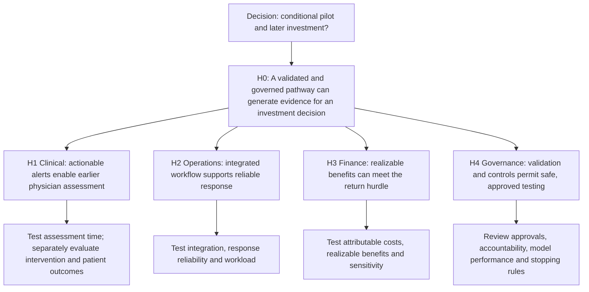

# Business Problem Structuring: Healthcare AI

**Hypothetical portfolio case | German 300-bed hospital | Clinical deterioration prediction**

This document adapts the IBM MECE Template Slides and Hypothesis Development Worksheet to an existing healthcare AI strategy case. All hospital, financial, clinical and operational inputs are hypothetical; no hospital data have been validated, no analysis has been performed, and no pilot has been completed. The accompanying Healthcare AI Strategy Consulting Case Study (12 November 2026) provides the underlying hypothetical case; the supplied PDF contains 10 pages.

## 1. Problem statement and decision

The strategic problem is that leadership of a hypothetical 300-bed hospital in Germany must decide whether to invest in AI-supported clinical deterioration prediction while its clinical, operational and financial benefits remain uncertain. The scope is adult inpatients on two proposed internal medicine pilot wards and the clinicians caring for them, over a proposed 12-week pilot and a three-year investment horizon; patient eligibility and the precise baseline period remain to be defined. The hypothetical base case implies a negative financial return, while an unsupported decision could consume scarce resources or introduce clinical and workflow risks. Success means obtaining sufficient evidence to decide whether to proceed, modify, stop or test further, using agreed clinical and financial measures and mandatory safety and governance gates.

**Decision:** Should leadership authorize a conditional 12-week, two-ward pilot of a purchased clinical deterioration prediction system, subject to approvals and validation, and what evidence would justify any subsequent investment?

**Two primary decision metrics** (definitions and thresholds to be agreed before testing):

1. **Time to physician assessment:** median elapsed time from a predefined deterioration trigger to documented physician assessment, compared with an appropriate baseline or comparator. This measures the intended early-response pathway, not patient benefit by itself.
2. **Three-year incremental ROI:** (incremental benefits − incremental costs) / incremental costs, using actual implementation timing and transparent assumptions. This tests the financial investment case.

Safety, model performance, alert burden and patient outcomes are essential supporting measures and gates; they are not replaced by these two metrics. Earlier assessment must lead to an appropriate and effective intervention before a patient outcome could improve; any financial saving requires an additional, separately evidenced resource or cost effect.

## 2. MECE decision structure and hypotheses

### Decision dimensions

The structure assigns each question to one primary decision dimension. Together they cover the decision criteria defined for this case; they are not an additive decomposition of a single metric or an exhaustive list of every possible cause.

```text
Should the hospital proceed with the proposed AI pilot and subsequent investment?
├── Clinical effectiveness: Does the pathway improve relevant clinical decisions and outcomes?
│   ├── Prediction performance and timely identification in the intended population
│   ├── Physician assessment after a trigger
│   ├── Appropriate and effective intervention after assessment
│   └── Patient outcomes, including unintended harms
├── Operational feasibility: Can the pathway work reliably in routine care?
│   ├── EHR integration and data flow
│   ├── Alert routing, staffing and response workflow
│   ├── Training, adoption and workload
│   └── Technical support and ongoing monitoring capability
├── Financial viability: Do incremental benefits justify incremental costs?
│   ├── Upfront and recurring costs
│   ├── Credible, attributable and realizable benefits
│   ├── Timing, uncertainty and sensitivity
│   └── Three-year ROI and affordability
└── Governance and safety: Is use authorized and appropriately controlled?
    ├── Clinical accountability and human oversight
    ├── Privacy, security and applicable regulatory review
    ├── Local validation, bias assessment and approval
    └── Incident management, monitoring and stopping rules
```

**Boundaries and dependencies:** Clinical effectiveness owns whether care and outcomes change; operations owns whether the workflow and technology can be delivered; finance translates evidenced resource changes into money; governance owns authorization, safeguards and accountability. A single issue can affect several dimensions—for example, alert overload is operational, may affect safety and can generate costs. Assign it to a primary owner and record cross-references rather than count its impact twice. These are distinct decision lenses, not independent causal mechanisms; their evidence and outcomes overlap.

### Financial baseline for discussion

The hypothetical case assumes **€120,000 initial investment**, **€90,000 annual costs**, and **€72,000 annual benefits** under a **20% avoided-transfer assumption**. Undiscounted three-year costs are €390,000 and benefits €216,000, giving **ROI = (€216,000 − €390,000) / €390,000 = −44.6%**. Assuming benefits scale linearly with the avoided-transfer rate and all other inputs remain constant, the financial break-even assumption is approximately **36.1%** (€130,000 required annual benefits / €360,000 annual benefits at a hypothetical 100% rate). This is a model sensitivity, not a clinically established target or feasible outcome.

The case assumes 12,000 annual admissions and values each truly avoided transfer at €1,500 in avoidable variable costs, both unvalidated. Its hypothetical 240 annual unplanned ICU transfers must not be treated as 240 preventable events. Eligibility, clinical avoidability, attribution and whether avoided transfers create cash savings or capacity benefits all require validation. Earlier appropriate ICU transfer may improve safety and increase transfer counts; a lower count can reflect delayed escalation, bed scarcity or case mix rather than benefit. Any 35% shorter assessment time, 15-minute additional workload or −12% ROI figures are unvalidated illustrative scenarios, not pilot findings. Discounting, implementation timing and benefit realization could change the result.

### Top-level and sub-hypotheses

**H0 — Conditional investment hypothesis:** If a locally validated prediction system can trigger timely physician assessment within a workable and governed care pathway, then a controlled pilot can establish whether it warrants further investment, because the decision currently lacks credible evidence on the pathway and its costs. This is a testable decision hypothesis, not a claim that patient outcomes or ROI will improve.

- **H1 — Clinical pathway:** If alerts identify eligible deterioration early enough and clinicians assess patients promptly, then time to physician assessment will fall compared with an agreed comparator, because the alert provides actionable information earlier. Plausibility depends on model performance, current practice and response behavior; none is established.
- **H2 — Operational pathway:** If alerts integrate into the EHR and defined ward workflow with manageable workload, then staff can respond reliably during a pilot, because the signal reaches an accountable clinician without disrupting care. Integration and workload are untested.
- **H3 — Financial pathway:** If clinically appropriate, attributable resource savings are large enough and realizable, then three-year incremental ROI may reach the leadership hurdle, because benefits would cover initial and recurring costs. The current hypothetical base case is negative.
- **H4 — Governance and safety:** If local validation, human oversight and required approvals are in place, then the proposed pilot may meet the hospital's governance and safety requirements, because risks and accountability can be assessed and controlled. Approval and acceptable performance are not assumed.

These are **complementary conditions for H0**, not mutually exclusive alternative explanations for one outcome. They align to the four decision dimensions, but can be true or false together; causation and dependencies need testing. An exhaustive causal decomposition would require a narrower, measured outcome and validation with stakeholders.

### Quality and data check

| Criterion | Assessment |
|---|---|
| Specific | Yes, provisionally: H1–H4 specify directional relationships and a defined setting; eligibility, comparators and thresholds need agreement. |
| Verifiable | Potentially: timestamps, logs, costs, validation and safety records could be obtained, subject to access, quality, time and approvals. A 12-week pilot may be too small to establish patient outcomes or causal savings. |
| Relevant | Yes: each hypothesis informs the investment decision or a necessary gate. |
| Not merely a symptom | Provisionally: each proposes a mechanism or condition, rather than simply restating uncertainty; whether it is a root cause remains to be tested. |
| Data availability and cost | No source is confirmed available. EHR extraction, vendor validation, staff time and information governance review may incur costs; estimates and access permissions are outstanding. |

## 3. Potential symptoms and underlying causes

These are hypotheses for investigation, not observed findings.

| Potential symptom | What could be observed if supported |
|---|---|
| Variable assessment timing | Wide variation in time from a defined deterioration trigger to physician assessment. |
| Workflow friction | Delayed or missed responses, or increased clinician workload associated with alerts. |
| Weak financial case | Incremental forecast benefits fall short of the cost and return requirements. The stated negative ROI is a hypothetical model output, not an observed hospital result. |

| Plausible underlying cause | Why it could explain symptoms |
|---|---|
| Trigger information and escalation are not reliably integrated into the clinical workflow. | A fragmented pathway could create variable assessment times and response friction; it must be investigated against actual workflow and data. |
| The model assumes a larger avoidable and monetizable share of transfers than can actually be realized. | If fewer transfers can be safely prevented or savings cannot be captured, modeled benefits would be overstated. This needs clinical and finance validation. |

## 4. Editable visual hypothesis tree

The following original Mermaid diagram is editable and renders on GitHub. The lab requires an AI-tool-generated tree exported as an image or PDF and a clear screenshot included in the working document. **Those export and screenshot requirements remain outstanding**; this Markdown diagram is not represented as a MyLens output or a screenshot.



The branches are linked decision conditions, not mutually exclusive causes. H1 and H3 are prioritized for the analysis plan; H2 and H4 remain essential feasibility and safety gates and must not be deferred if needed before any pilot.

## 5. Prioritization and analysis plan

### Priority assessment

Ratings are provisional judgments, not findings; uncertainty is high for all branches because data availability and performance are unconfirmed. Validate priorities with clinical, operational, finance and governance stakeholders.

| Hypothesis | Impact | Uncertainty | Plausibility | Testability | Priority and rationale |
|---|---|---|---|---|---|
| H1 Clinical pathway | High | High | Medium, unvalidated | Medium | First analytical priority: tests the core early-assessment mechanism; comparability and event counts may limit inference. |
| H3 Financial pathway | High | High | Medium, unvalidated | Medium | Second analytical priority: negative base case makes benefit realization and cost sensitivity decisive. |
| H2 Operational pathway | High | High | Medium, unvalidated | Medium | Test in parallel as a prerequisite for a credible pathway. |
| H4 Governance and safety | High | High | Medium, unvalidated | Medium | Mandatory gate before pilot; review in parallel, irrespective of analytical ranking. |

### Two prioritized hypotheses: proposed work only

| Element | H1: Clinical pathway | H3: Financial pathway |
|---|---|---|
| Analysis | Define eligible events and a trigger; compare trigger-to-assessment times with a suitable baseline or comparator, assess event counts and uncertainty, and review alerts, missed events and unintended effects. Separately track intervention and outcomes without assuming causation. | Rebuild the three-year incremental model; validate unit costs, eligible and clinically avoidable transfers, attribution and realizable savings; run sensitivity and break-even scenarios. Avoid double counting and distinguish cash savings from capacity. |
| Data and source | EHR timestamps, patient eligibility, vital signs/triggers, assessment records, alert logs and interventions; ward process mapping and model validation documentation. | Finance and vendor cost estimates; implementation and staffing costs; transfer records; clinician assessment of avoidability; unit costs and evidence of actual resource release. |
| Availability / gap / cost | Availability unknown. Timestamp quality, access, event definitions and comparator are gaps; extraction and clinical review require staff time and possibly vendor support. | Availability unknown. Incremental costs, transfer attribution and realizable savings are gaps; finance and clinical review may incur staff and vendor costs. |
| Expected output | Baseline and pilot comparison with definitions, sample size, uncertainty, safety observations and limitations; no claim of patient benefit from faster assessment alone. | Transparent cost-benefit model, sensitivities, break-even assumptions and a range of potential returns, with unverified inputs flagged. |
| Proposed owner | Clinical lead and ward physicians, supported by clinical informatics and analytics. | Finance lead, supported by clinical lead, operations and procurement. |
| Indicative timeline | Before pilot: 2–4 weeks for definitions, data access and baseline, subject to approvals; during 12-week pilot: prospective collection; 2–4 weeks afterward for review. | Before pilot: 2–4 weeks for model and data audit in parallel; update during pilot and 2–4 weeks afterward. Estimates only, dependent on access and staffing. |
| Illustrative decision rule | Before collection, agree a clinically meaningful improvement threshold, comparator and safety limits. Support requires meeting the threshold with acceptable data quality and no breach of safety rules; otherwise modify, stop or test further. An inconclusive result is neither pass nor fail. | Before analysis, agree the return hurdle, cost boundaries and realization rules. Support requires the model to meet that hurdle under documented, credible assumptions; failure or inconclusive evidence triggers modification, stopping or further testing. |

**Safety and operational gate:** Before any patient-facing use, confirm applicable approvals, funding, local validation and performance, patient eligibility, clinical accountability, privacy and security controls, validated data feeds, a frozen model version, alert routing, monitoring, escalation and a tested fallback. Pause live alerts for suspected system-related serious harm, missed or delayed essential escalation, unsafe patient identification, critical feed failure or unauthorized access; return to usual care and investigate. An unresolved safety gate means stop. The pilot is proposed only and is conditional on satisfying these requirements. Physician and nursing teams retain clinical responsibility.

### Interpretation and decision implications

No hypothesis has yet been supported or rejected. If H1 is supported, earlier assessment provides evidence about a process, not proof of effective treatment or improved patient outcomes. If H3 remains below the agreed hurdle, leadership can consider modifying the design, testing further, or stopping; a nonfinancial rationale would need explicit justification. Any decision to scale requires a separate review of clinical outcomes, safety, operational feasibility, governance and finance. Document findings, confidence, risks, owners and tracking arrangements after the work, rather than treating planned outputs as results.

### Open assumptions and reflection

- Confirm ward selection, adult eligibility, deterioration trigger, comparison wards, baseline period, comparator and timestamp definitions with clinical stakeholders. The source case also proposes median time from alert delivery to first documented doctor contact; this differs from trigger-to-assessment time and must be reported separately, not compared as if the two clocks were identical.
- Agree clinical and financial thresholds, monitoring ownership, event counts needed for useful interpretation, stopping rules and whether 12 weeks is adequate.
- Validate vendor claims, local data quality, staffing capacity, patient privacy arrangements, costs and the causal and financial assumptions behind avoided transfers.
- Hypothesis-led structuring focuses the work on the investment decision while making uncertainties visible. It does not establish that the listed branches capture every root cause, and it leaves broader strategic alternatives and long-term patient effects for further work as evidence warrants.

## Template and submission note

Adapted from the supplied **Healthcare AI Strategy Consulting Case Study** (12 November 2026), IBM **MECE Template Slides** and **Hypothesis Development Worksheet**, alongside the lab instructions. The case recommends against hospital-wide deployment on current financial data and considers a conditional pilot only after prerequisites are met. The worksheet also describes a separate PDF/DOCX submission to an AI grader; this portfolio Markdown is not that completed submission. The original lab's exported AI-tool image/PDF and screenshot remain to be produced and inserted.
